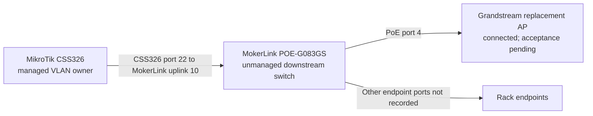

# Decision 023: MokerLink POE-G083GS Rack PoE Switch

## Status

Accepted as an inventory and topology record for the existing device (2026-10-23).
This does not make the MokerLink a VLAN configuration owner or establish that
every tagged VLAN currently passes through it.

## Context

The owner clarified that the MokerLink is already installed downstream of the
MikroTik CSS326. It connects the network cabinet to rack equipment and is not a
replacement for the CSS326. Earlier discussion incorrectly treated it as a
possible substitute for the core managed switch.

The device is the MokerLink **POE-G083GS**, an unmanaged switch. The owner's
product images and the [manufacturer's listing](https://www.mokerlink.com/index.php?route=product/product&product_id=377)
identify the ports and advertise PoE watchdog/AI detection and QoS. Where the
product marketing does not identify a setting or exact behavior, this record
does not infer one.

## Decision

- Keep the CSS326 as the configurable core switch and owner of the established
  VLAN trunk configuration.
- Use the POE-G083GS only as the existing downstream rack access/PoE switch.
  Its unmanaged status means it is not the place to configure tagged VLANs.
- Preserve the owner-confirmed Extend position for now. Change the DIP only
  for a specific need with a controlled link/client acceptance test; do not
  assume the installed switch is in Default mode.
- Do not claim that the PoE watchdog is configurable or limited to the two QoS
  ports. The available product information does not document its enable/disable
  control, exact trigger, or per-port scope.
- Do not assume VLAN transparency from the Ethernet link being connected. Record
  the actual uplink ports and verify the required tagged/native VLAN path before
  relying on this switch for a new AP.

## Advertised Hardware Specification

| Item | POE-G083GS specification |
|------|--------------------------|
| Switching | Unmanaged Gigabit Ethernet; 11 physical ports |
| PoE access | Ports 1-8; IEEE 802.3af/at active PoE; up to 30 W per port advertised |
| Total PoE budget | 120 W shared total advertised; simultaneous port output is budget-limited |
| RJ45 uplinks | Ports 9-10; Gigabit Ethernet |
| SFP uplink | Port 11; Gigabit SFP |
| QoS | Product graphic/listing identify QoS priority on PoE ports 1-2 only |
| Watchdog | Product listing advertises PoE watchdog/AI detection that automatically restarts a disconnected/offline attached device; exact algorithm and port scope are unspecified |
| DIP mode | Extend, owner-confirmed 2026-10-27; unchanged. Product graphic advertises that Extend prevents PoE ports 1-8 communicating with each other while allowing communication to uplink ports 9-11. Actual link speed and tagged-VLAN transport remain unverified. |
| Extend/VLAN caveat | The vendor illustration calls the resulting partitions port-based VLANs, but this unmanaged switch has no documented per-port 802.1Q configuration interface. Do not treat Extend as a configurable multi-VLAN trunk or enable it on the AP path without testing. |
| Passive PoE | Manufacturer listing says passive 24 V PoE is not supported |

The manufacturer's product graphic advertises 12 Gbps switching capacity and
8.92 Mpps forwarding. These are vendor claims, not measured performance or
evidence of VLAN behavior in the installed topology.

## Powering The Replacement AP

The owner has a MokerLink POE-G083GS in the downstream rack path. The
received Grandstream GWN7660E advertises IEEE 802.3af/at and maximum 12.95 W
consumption. It is connected directly to PoE port 4, with `NET/POE` connected
confirmed in its native status menu on 2026-10-27. The shared PoE load has not
been measured. No separate injector is used in this arrangement. Do not insert
a 24 V passive injector. The MokerLink watchdog may
power-cycle a PoE endpoint when its undocumented detection logic considers it
offline; sustained AP uptime should be checked after connection.

## Topology And Open Facts

On 2026-10-27, the owner confirmed the installed path: CSS326 port 22 connects
to MokerLink uplink port 10, and the newly arrived Grandstream AP connects to
MokerLink PoE port 4. These are owner-reported physical connections, not an
end-to-end tagged-VLAN acceptance test. Preserve port 22's existing native
management path; this record does not authorize changing its VLAN settings.

The owner also confirmed Extend mode and reuse of the established SSID names
on the Grandstream. Neither establishes SSID configuration or VLAN acceptance.

These details remain unverified:

- Which devices use the other PoE ports and the total live PoE load.
- The precise PoE-watchdog trigger, scope and whether it can be disabled.
- Whether the required native management and tagged client VLANs currently
  traverse this installed path end to end.

Record these only after visual inspection or a bounded network test. Do not
toggle Extend mode as a diagnostic shortcut.

## References

- [Device inventory entry](../device-inventory.md#switch-rack-poe).
- [Manufacturer POE-G083GS specifications and marketing diagram](https://www.mokerlink.com/index.php?route=product/product&product_id=377).
- [Rack and switch path inventory](../device-inventory.md#rack-connections).
- [WAP purchase and VLAN acceptance requirements](../buy-order.md#acceptance-before-cutover).