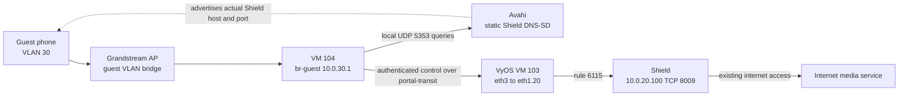

# Guest Wi-Fi Troubleshooting

Guest Wi-Fi is active on both 2.4 and 5 GHz through the Grandstream AP and the
retained openNDS gateway. Native acceptance and a real phone consent flow passed;
see the [current AP](wifi-architecture.md#replacement-ap-target-not-yet-deployed).

Start with [Wi-Fi architecture](wifi-architecture.md) for the accepted topology
and [gateway operations](../../terraform/proxmox/guest-portal/README.md) for
enforcement ownership. Use the supported Node 24 controller environment and
existing private credentials from [controller setup](controller-setup.md).

## Identify The Failing Boundary

| Symptom | First check | Do not assume |
|---------|-------------|---------------|
| SSID missing | Independent over-air scan; guest is configured on both bands | A configured profile proves beacon visibility |
| SSID visible, association fails | Selected SSID and current Bitwarden key; client radio support | A portal failure explains WPA authentication |
| Associated, no lease | Guest VLAN 30 bridge path and Technitium scope/service | The AP or VyOS should start a replacement DHCP server |
| Lease, no internet before consent | Check portal reachability and client captive detection | Pre-auth internet denial is a fault |
| Consent fails | HTTPS origin, signed offer/cookie and native Authmon readiness | Disabling Origin validation is a fix |
| Internet fails after consent | Native openNDS session, fresh lease facts, transit and upstream policy | A successful page render proves enforcement authorization |
| Private/admin destination blocked | Compare the documented isolation policy | Broad inter-VLAN access should be opened for troubleshooting |
| AP SSH fails but HTTPS works | Existing management jump and trusted host identity | The AP needs a reboot or firewall exception |

Guests use `silence of the lans`, a `10.0.30.0/24` lease, gateway `10.0.30.1`
and VLAN-local Technitium DNS `10.0.30.30`. Consent is at
`https://guest.owl.red`. The AP does not route, NAT, serve DHCP or enforce sessions.
Do not use the retired `captive.owl.red` address or expect DHCP option 114.

## Read-Only Controller Checks

Use the Grandstream's native SSH `1` / Status menu through the documented
[bootstrap access](wifi-architecture.md#bootstrap-discovery-and-access).
Preserve strict host-key checking. Production Manager inspection is available:

```bash
node scripts/gwn-manager-run.mjs inspect-production
node scripts/gwn-manager-run.mjs ap-plan-production
```

Share only sanitized status, never credentials. The native SSH menu is not a
general shell and its access may be controlled by Manager.

Verify each configured SSID's VLAN mapping and an independent over-air scan;
then test association and the intended VLAN's lease. Management reachability
does not prove tagged transport. Do not change workstation routes, DNS or SSID
association merely to manufacture a passing result.

## Bounded End-To-End Acceptance

The existing fixture creates a temporary production guest namespace, requests a
real lease, exercises HTTPS consent/native Authmon, tests established-connection
revocation and private/admin/IPv6 denial, then releases the lease and removes its
namespace. It is not read-only: use it only with approval for that bounded test.

```bash
ANSIBLE_CONFIG=ansible/ansible.cfg .venv/bin/ansible-playbook \
  -i ansible/inventory/hosts.yml ansible/playbooks/guest-portal-acceptance.yml \
  -e portal_acceptance_allowed=true
```

Expected result: `PRODUCTION_GUEST_DHCP_HTTPS_CONSENT_REVOKE_PRIVATE_IPV6_PASS`.
This checks the wired guest enforcement path, not handset compatibility or RF
coverage. A real browser login was owner-confirmed; coverage and broader handset
testing remain [roadmap work](../../ROADMAP.md#network-follow-ups).

## Shield Casting Trial Preparation

The owner selected internet casting to the Shield only; local-file casting is
deferred and the TV stays offline. App-name restrictions are not required.
The bounded discovery/control configuration is active. Native consent and
isolation acceptance passed, and the owner reports YouTube/Spotify playback
starts. Phone control can be lost when the app is backgrounded or the screen
locks while media continues playing. The owner considers this minor; deeper
background-control investigation is deferred, not treated as full app acceptance.

Live router neighbor and passive mDNS checks on 2026-10-31 verified:

- Shield `10.0.20.100`, MAC `3c:6d:66:0e:1f:67`, on private `eth1.20`.
- Instance `SHIELD-Android-TV-48ca569af8f5ca9a97a5cac5a1dd6b35`.
- `_googlecast._tcp` SRV target
  `48ca569a-f8f5-ca9a-97a5-cac5a1dd6b35.local`, TCP port `8009`.

The selected discovery approach is Avahi's supported static DNS-SD publication
on `br-guest`, not a cross-VLAN reflector. Prepared configuration is in
`ansible/files/guest-casting/`. There is no new private-VLAN interface, IPv6
publication or general service reflection. The gateway runs the maintained
Avahi daemon. Generic service discovery is not proof that every app-specific
discovery method works; dynamic receiver state and app subtypes are not copied.

The owner accepts the Shield's discovery name being visible before consent.
Control remains authentication-gated. Static publication can outlive an offline
receiver or stale metadata: requalify the records after a reset, rename or
address change. This bounded one-receiver configuration is not a scalable
dynamic discovery inventory.

The deployed `control.nft` passed native validation against the live
gateway. It inserts mDNS input for fresh guest leases and only authenticated
TCP `8009` forwarding to the Shield plus established replies, before the
private-destination drop. Existing pre-offload lease checks, native marks,
revocation and IPv6 denial remain required. Native acceptance verified typed
Shield-only DNS-SD answers, pre-consent control denial, authenticated TCP 8009,
denial of other Shield/private services, revocation and IPv6 denial. These tests
do not certify background phone control. Rule comments provide counter attribution.

openNDS's earlier `ndsRTR` chain also needs its supported `users-to-router`
UDP 5353 allowance. The dedicated playbook persists that native option and
bootstraps a scoped live rule without restarting openNDS; its start timestamp
was verified unchanged. dnspython parses mixed PTR/TXT/SRV/A answers by type.

Before a trial, capture both firewall preimages and persistent files, verify
independent recovery and review the exact inverse. Do not run the full gateway
or router transit playbook: add only the selected discovery/control changes.
VyOS rule 6115 is the confirmed exception before the guest private-destination
drop: `eth3` to `eth1.20`, source `10.0.30.0/24`, destination `10.0.20.100`,
TCP 8009 only. The dedicated router playbook requires reload, not reboot,
rollback. Do not attempt a second commit-confirm during a pending window;
close gateway casting first and allow native rollback on a failed trial.

Use a real guest phone to verify discovery, pre-consent control denial,
post-consent internet casting and continued denial of other private hosts and
Shield services. Local-file playback may create new Shield-to-phone connections;
capture their actual ports before adding any reverse exception. Do not guess
all ephemeral ports or equate established Cast replies with local-media support.
Consent revocation and IPv6 denial passed in the native fixture. Actual lease
expiry and broad handset/app compatibility remain unqualified. Static metadata
can become stale, and the background-control limitation remains unresolved.
Two background packet captures returned unknown outcomes and produced no saved
artifacts; they provide no evidence of a firewall drop or a phone-side closure.

### Component Layout And Traffic Path

| Component | Placement | Responsibility |
|-----------|-----------|----------------|
| Grandstream AP | Existing VLAN-tagged guest SSID | Bridges guest clients into VLAN 30; client isolation remains enabled. No new SSID, AP portal or AP discovery gateway is introduced. |
| Technitium | Existing VLAN-local DNS/DHCP at `10.0.30.30` | Issues guest leases. The existing gateway lease synchronizer supplies short-lived lease facts to the forwarding guard. It does not publish Cast discovery records. |
| Guest gateway | Debian VM 104 on edge | `br-guest` is `10.0.30.1/24`; `portal-transit` is `172.31.30.2/30`. Runs openNDS, lease guards and the new Avahi publisher. |
| Portal application | Existing Kubernetes HTTPS origin `guest.owl.red` | Presents consent and the signed FAS handoff. Native openNDS/Authmon authorizes the client; Avahi does not authorize sessions. |
| VyOS | Existing VM 103 on edge | Receives guest traffic on `eth3`, transit `172.31.30.1/30`; rule 6115 permits only Shield TCP 8009 toward `eth1.20`. |
| Shield | Existing private VLAN 20 | Receiver at `10.0.20.100`, not the guest gateway. Fetches internet media through its existing connectivity. The TV remains offline. |



Discovery and control are separate paths. Avahi answers guest-side mDNS using
the captured static records; it does not forward private-VLAN multicast or
proxy Cast TCP. The phone then connects to the advertised Shield address.
That control connection crosses both gateway and VyOS policy. Media fetched
by the Shield is not relayed through Avahi or served by the guest phone.

### Installed Packages And Files

The dedicated gateway playbook installs Debian `avahi-daemon` and
`python3-dnspython`, without recommended packages. Package auto-starts are
suppressed with `policy_rc_d: 101`; configuration is installed before the
playbook enables and starts `avahi-daemon`. dnspython is for acceptance-test
DNS parsing, not a custom discovery service or session broker.

| Repository source | Installed destination or use |
|-------------------|------------------------------|
| [avahi-daemon.conf](../../ansible/files/guest-casting/avahi-daemon.conf) | `/etc/avahi/avahi-daemon.conf`: IPv4 only, `allow-interfaces=br-guest`, reflection disabled; automatic address, workstation, HINFO and domain publication disabled. |
| [hosts](../../ansible/files/guest-casting/hosts) | `/etc/avahi/hosts`: one static mapping from the captured receiver hostname to `10.0.20.100`. |
| [shield.service](../../ansible/files/guest-casting/shield.service) | `/etc/avahi/services/shield.service`: one IPv4 `_googlecast._tcp` service, actual receiver hostname, port 8009, and captured `id`, `ve`, `md`, `fn`, `ca` TXT fields. |
| [control.nft](../../ansible/files/guest-casting/control.nft) | Applied atomically to the existing kernel tables; its discovery and control rules are also persisted in the existing guard files below. |
| [guest-portal-acceptance.py](../../ansible/files/guest-portal-acceptance.py) | `/usr/local/libexec/guest-portal-acceptance.py`, mode 0600, installed by the existing acceptance playbook. |

The Avahi configuration and host mapping are installed mode 0644 with backups;
the service XML is mode 0644. The apply lane refuses unrelated static service
files rather than advertising other services to guests. No credentials are
embedded in these discovery files. The static mapping does not depend on the
unicast `shield.owl.red` record.

### Firewall Ordering And Persistence

| Rule comment | Kernel location | Match and effect | Persistence |
|--------------|-----------------|------------------|-------------|
| `owl-shield-nds-input` | `ip nds_filter`, `ndsRTR` | Accepts guest-interface UDP 5353 only toward `10.0.30.1` or `224.0.0.251`. This gets discovery past openNDS's earlier local-input rejection. | Bootstrap rule for the running daemon; the supported `FirewallRule allow udp port 5353` is added inside `users-to-router` in `/etc/opennds/opennds.conf`. |
| `owl-shield-discovery` | `inet owl_portal_guard`, `input` | Same local mDNS destinations, but source must be in `@technitium_leases`. The later guard still denies other guest access to gateway services. | `OWL-SHIELD-DISCOVERY` block appended to `/etc/owl-guest-portal/guard.nft`. |
| `owl-shield-control-out` | `inet owl_portal_guard`, `forward` | `br-guest` to `portal-transit`, guest source to Shield TCP 8009, new/established state, native authenticated packet mark. | `OWL-SHIELD-CONTROL` block appended to `/etc/owl-guest-portal/enable-forward.nft`. |
| `owl-shield-control-in` | `inet owl_portal_guard`, `forward` | Shield TCP source 8009 to guest destination, `portal-transit` to `br-guest`, established state and native authenticated packet mark. No new receiver-initiated connection is allowed. | Same control persistence block. |

The native authentication test is `meta mark & 0x30000 == 0x30000`; the separate
pre-offload ingress chains continue checking fresh lease facts in both
directions. The new control rules are inserted ahead of the private-destination
drop; they do not replace that drop, flush a table or add an untrusted bypass.
VyOS still applies its own exact destination/interface/port rule. Consent
enforcement belongs to the gateway, not to VyOS rule 6115 alone.

The persistent openNDS option is surrounded by `OWL-SHIELD-NATIVE-MDNS`
markers. The bootstrap avoids restarting the active daemon; a later normal
openNDS start generates its own local-port rule from configuration. Persisted
configuration is not proof of a full cold-boot acceptance test.

These additions are owned by dedicated playbooks, not by a new Terraform VM
definition or a Fleet application. Replaying the full base gateway setup can
overwrite the guard/configuration files and remove the additions. Treat that
as a coordinated maintenance change, not an ordinary casting health check.

### Guarded Setup Sequence

The deployed setup does not need to be applied again. The following is the
provisioning sequence for a reviewed new or intentionally rolled-back setup.
Use current preimages and independent recovery first. The gateway apply lane
refuses existing `owl-shield-*` guard rules, and router `plan`/`prepare` require
rule slot 6115 to be unused. These are collision guards, not an idempotent
reapply or repair command.

1. Review the native router candidate using
   [guest-shield-casting-router.yml](../../ansible/playbooks/guest-shield-casting-router.yml).
   `plan` displays the single-rule diff and discards the candidate.
2. Apply [guest-shield-discovery.yml](../../ansible/playbooks/guest-shield-discovery.yml)
   to the existing gateway. It checks proposed nft rules, configures static
   discovery and persistence, inserts the four rules, and starts only Avahi.
3. Run router `prepare`. It applies only rule 6115 under a five-minute native
   commit-confirm window; it requires rollback action `reload`, not `reboot`.
4. Run the opt-in Shield checks in the existing
   [guest-portal-acceptance.yml](../../ansible/playbooks/guest-portal-acceptance.yml).
5. Confirm and save only after native acceptance passes and actual router
   state matches the reviewed rule. Phone playback is a separate acceptance
   step; a socket connection alone is not proof of usable app control.

Commands are run from the repository root, only under the approved boundary:

```bash
ANSIBLE_CONFIG=ansible/ansible.cfg .venv/bin/ansible-playbook \
  -i ansible/inventory/hosts.yml ansible/playbooks/guest-shield-casting-router.yml \
  -e shield_cast_allowed=true -e shield_cast_phase=plan

ANSIBLE_CONFIG=ansible/ansible.cfg .venv/bin/ansible-playbook \
  -i ansible/inventory/hosts.yml ansible/playbooks/guest-shield-discovery.yml \
  -e shield_cast_allowed=true

ANSIBLE_CONFIG=ansible/ansible.cfg .venv/bin/ansible-playbook \
  -i ansible/inventory/hosts.yml ansible/playbooks/guest-shield-casting-router.yml \
  -e shield_cast_allowed=true -e shield_cast_phase=prepare

ANSIBLE_CONFIG=ansible/ansible.cfg .venv/bin/ansible-playbook \
  -i ansible/inventory/hosts.yml ansible/playbooks/guest-portal-acceptance.yml \
  -e portal_acceptance_allowed=true -e shield_cast_expected=true

# Only after the preceding acceptance and independent state verification pass:
ANSIBLE_CONFIG=ansible/ansible.cfg .venv/bin/ansible-playbook \
  -i ansible/inventory/hosts.yml ansible/playbooks/guest-shield-casting-router.yml \
  -e shield_cast_allowed=true -e shield_cast_phase=confirm \
  -e shield_cast_acceptance_passed=true
```

Shield acceptance additionally reports
`PRODUCTION_GUEST_SHIELD_DISCOVERY_CONSENT_REVOKE_ISOLATION_PASS`. The opt-in
playbook sets `OWL_SHIELD_CAST_EXPECTED=1` for the fixture; ordinary portal
acceptance leaves the Cast-specific assertions disabled. The fixture uses a
real guest DHCP lease and namespace, observes native Authmon acknowledgement,
and cleans up its own client. Its readiness check selects the current boot's
relevant Authmon startup marker rather than the last 200 unrelated entries.

### Removal And Recovery

Close guest-side casting first with
[guest-shield-discovery-rollback.yml](../../ansible/playbooks/guest-shield-discovery-rollback.yml):

```bash
ANSIBLE_CONFIG=ansible/ansible.cfg .venv/bin/ansible-playbook \
  -i ansible/inventory/hosts.yml ansible/playbooks/guest-shield-discovery-rollback.yml \
  -e shield_cast_rollback_allowed=true
```

This stops/disables both Avahi service and socket, removes only the four named
kernel rules by their current handles, and removes the three owned persistence
blocks. It does not flush native tables, clear other lease facts, restart
openNDS, uninstall packages or delete the installed Avahi configuration files.
It expects the named bootstrap rule to exist; after a native restart has
regenerated that rule without its bootstrap comment, stop and inspect rather
than forcing this rollback lane through an incomplete boundary.

For an unconfirmed router trial, allow the known native reload rollback to
complete and verify rule 6115 is absent. Do not start a nested removal commit.
For an already confirmed rule, the dedicated router lane uses `remove`, then
independent verification of active rule absence, then `confirm-removal` with
`shield_cast_rollback_passed=true`. Never set that flag solely because the
removal command returned success. Verify gateway rules/configuration, native
portal health and actual router absence against their preimages afterward.

## Stop And Escalate

Do not replay gateway stage/preparation, transit handoff, firmware apply or AP
reboot as a health check. Do not flush security rules, bypass lease freshness,
disable IPv6 isolation or weaken the FAS Origin/cookie/signature checks. The
intentional failure mode is denial rather than unauthenticated forwarding.

Capture the failing boundary, sanitized error, time and affected client/VLAN.
If a live apply timed out, inspect actual state before retrying: the outcome may
be unknown. Firmware reset/recovery requires a new approved outage and qualified
local recovery access. A VyOS VM lifecycle apply is not AP recovery; the provider previously
restarted the router despite `reboot=false`.