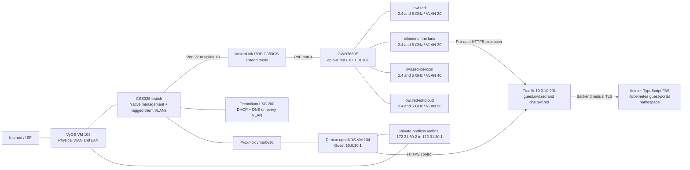
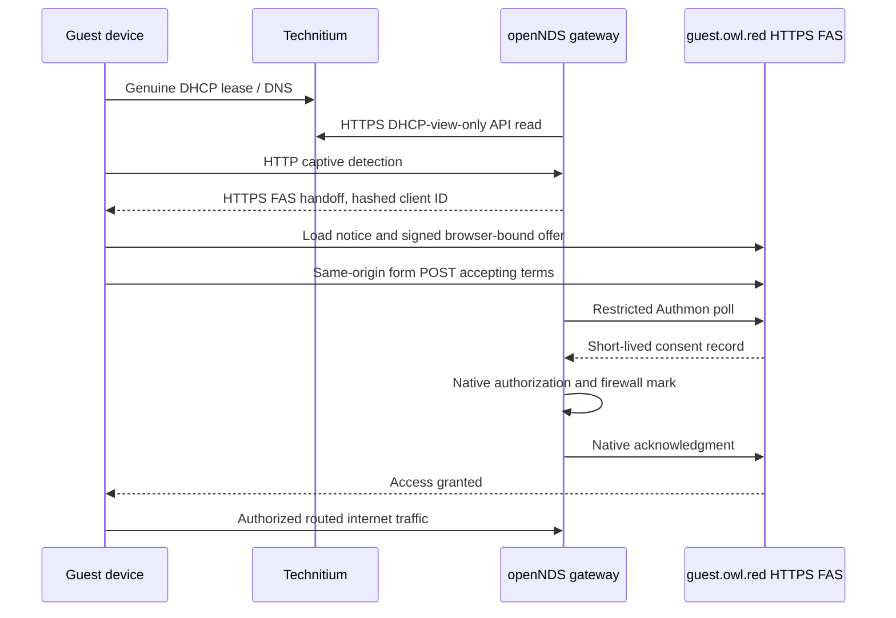

# Wi-Fi Architecture And Operations

<a id="replacement-ap-target-not-yet-deployed"></a>

## Current Access Point

The Grandstream GWN7660E is adopted by the production GWN Manager on 2026-10-27.
It reports firmware `1.0.25.34`, device MAC `ec:74:d7:b3:3e:ba`, online/paired
state and successful configuration. All four established SSIDs broadcast on
both 2.4 and 5 GHz: eight BSSes total. Independent Windows scans verified both
bands and WPA2-Personal/CCMP for every SSID. The user confirmed private internet
and the guest consent flow on a phone. Keep identical names and VLAN/security
policy across bands; this acceptance is not a coverage or throughput survey.

The owner confirms the installed path: **CSS326 port 22 -> MokerLink uplink 10
-> MokerLink PoE port 4 -> GWN7660E NET/POE**. The MokerLink POE-G083GS supplies
power directly; no separate injector is used. Preserve port 22's existing native
management/client path. The owner confirmed the MokerLink DIP is in **Extend**
on 2026-10-27; leave it unchanged pending a specific need and controlled test.
CSS326 port 22 now retains native management and carries tagged VLANs
20/30/40/50; existing VLAN members and per-port native settings were preserved
and read back. Private and guest service through the installed path are
phone-confirmed. Exact link speed, Extend-mode performance, broader IoT
integration checks and cross-band client-isolation testing remain follow-ups.

### VLAN Audit And Port Cleanup

Manager readback confirms all four SSIDs have VLAN tagging enabled: private
`20`, guest `30`, local IoT `40`, cloud IoT `50`, on both bands. The AP bridges
clients without NAT; untrusted SSIDs retain client isolation. Manager's portal
is disabled because openNDS owns guest enforcement. The enabled, untagged wizard
SSID `GWN Manager` was archived privately and deleted; only the four intended
tagged profiles remain.

The infrastructure subnet `10.0.10.0/24` currently travels **untagged with
PVID 1**, not as tagged VLAN 10. CSS326 ports `22` (rack/AP), `24` (edge/DNS/guest
gateway) and `25` (VyOS) carry the required client tags plus native management.
Guest routing uses openNDS over its dedicated VyOS transit, not a second direct
VyOS guest gateway; Technitium remains the DHCP authority.

Unused port `18` is removed from VLANs 20/30/40/50 and disabled. Port `20` was
the temporary Telus router, now removed by the owner; it is also disabled. Both
are named `unpatched-<port>`. The bounded switch reconciler saved a private
preimage, verified unchanged active-port/native settings and all writable link
fields, and passed an idempotent repeat. Recovery is under controller-local
`~/.local/state/owl-red/wifi-switch-retire-uLXarQ/`; use the same directory and
`wifi_switch_phase=rollback` through the approved switch playbook to restore
that exact preimage, after reviewing the intended effect of re-enabling ports.

**Functional trunks are not complete ingress isolation.** Remaining enabled
ports still use Optional/Any/PVID 1. Optional mode does not reject unknown VLANs,
and lacks Strict mode's ingress membership checks. Before hardening, declare
native VLAN 1 membership and recovery access, retain hybrid native/tagged trunks,
and classify access ports to reject client-supplied tags. Review retained CP1
port `2` membership in VLAN 20. Do not blanket-change PVIDs to 10 or enable Strict
without the native membership plan. The unmanaged MokerLink cannot enforce
per-endpoint tag permissions on its shared uplink.

### Bootstrap Discovery And Access

- Management: `ap.owl.red` / `10.0.10.107`, reserved for the verified device MAC
    in Technitium. `gwn-direct.owl.red` identifies the controller's static
    `10.0.10.32`; normal browser access is `https://gwn.owl.red` through ingress.
- SSH login: `admin`; the supplied temporary password remains only in the ignored
    controller secret input under variable `grandstream`. Its file permissions
    were verified as `0600`. Rotate and move it to the established secret store
    during an explicitly scoped credential change; no rotation was performed here.
- Discovery used the existing trusted edge host `10.0.10.3` as the SSH jump.
    The edge neighbor entry matched the MAC above. The AP host key was discovered
    through that host and pinned at controller-local
    `~/.local/state/owl-red/grandstream-discovery/known_hosts`; subsequent login
    enforced strict host-key checking. This is first-use discovery, not independent
    manufacturer identity attestation.
- The native SSH menu's `1` / Status screen supplied the identity above.
    General shell commands are not applicable to this menu.
- A native factory reset switched the AP from embedded Master to Slave.
    The supported SSH menu `11` / Manager Settings was used to set and save
    `10.0.10.32:10014`. The AP then paired with Manager. This is bootstrap only;
    steady-state WLAN configuration is owned by Manager's documented local API.

This guide describes the deployed AP layout and the retained routing and portal
infrastructure. Passwords, API tokens, private keys and recovery snapshots stay
outside Git.

## Local Manager API Qualification

On 2026-10-27, the existing WSL GWN Manager at `https://localhost:8443` was
qualified as a temporary controller-side test environment. It is not the
production endpoint and must not be used as the future Homepage link.

The production hostname and URL are **`gwn.owl.red`** and
**`https://gwn.owl.red`**. The unprivileged NixOS LXC is deployed on edge as CT
`201`, with static native-management address `10.0.10.32/24`, 2 CPU cores,
4 GiB memory and a 24 GiB local root disk. The URL has trusted frontend TLS,
verified backend CA/IP identity and management/owner access restrictions, and
is linked from Homepage. The contact email is `admin@owl.red`.
The initial 6 GiB allocation was reduced live without a service restart. The
vendor stack used roughly 3 GiB; 4 GiB retains working headroom and 512 MiB swap.
No OOM event was observed after the reduction. A 2 GiB limit is not qualified.
The [controller manifest](../../ansible/vars/gwn-manager.json) references the
existing Bitwarden Password Manager entry **GWN Manager**. Reuse that login
username/password when initializing production; do not generate or log a new
login implicitly. API app credentials are separate, instance-specific secrets.

### Proven Controller Behaviour

- The saved vault account successfully logs into the local `/user/app/login`
    account service, then establishes the `/app/login` Manager session. Sending
    credentials directly to the second route fails; that is not proof of a bad
    vault password.
- API Developer Mode was enabled on the temporary WSL instance. Local OAuth
    client-credentials tokens and signed official API requests work without cloud
    authentication.
- An isolated network with a counted zero-AP inventory passed SSID
    create/list/read/update/delete. The disabled, unbound fixture verified VLANs
    20/30/40/50, `2,5` versus `2` band selection, client isolation, WPA2-Personal
    and exact PSK equality. The owned test SSID and network were deleted.
- Security requires **`ssidSecurityType: 1`** as well as
    `ssidEncryption: 3` and `ssidWpaEncryption: 0`. Omitting the security-type
    discriminator defaulted to Open during the disabled test. Always verify
    actual security mode after writes; API success alone is insufficient.
- The official AP-list endpoint returned an empty string for an empty fixture,
    rather than a counted list. The qualification probe independently verified
    native `/app/ap/configure/list` inventory as `total=0` and `result=[]` before
    writes or network cleanup. Do not equate an unrecognized response with zero
    devices.
- Production account login, local API tokens, signed requests, adopted-AP
    configuration and repeated no-change SSID reconciliation passed. Trusted
    `https://gwn.owl.red` returns HTTP 200 through the real ingress. Backend TLS
    uses the controller's generated public CA, not an insecure transport override.

The [local probe](../../scripts/gwn-manager-run.mjs) uses the supported Node 24
runtime, the established private Bitwarden CLI/profile, and built-in HTTPS and
crypto modules. Its self-signed TLS exception is restricted to fixed loopback
`https://localhost:8443`; do not copy it into production. Credentials, cookies,
tokens and PSKs stay out of output. Private API material and sanitized test
records live under `~/.local/state/owl-red/gwn-manager/`, outside Git.

```bash
node scripts/gwn-manager-run.mjs inspect-local
node scripts/gwn-manager-run.mjs api-local
GWN_MANAGER_QUALIFY_ALLOWED=true node scripts/gwn-manager-run.mjs enable-api-local
GWN_MANAGER_QUALIFY_ALLOWED=true node scripts/gwn-manager-run.mjs qualify-local
```

The last two commands mutate only the fixed local test controller. Production
operations use explicit `-production` phases and a separate API credential.
Production backend TLS is verified; the loopback self-signed exception is not
used there. AP-reset permission does not imply unrelated infrastructure changes.

### Production Operations

```bash
node scripts/gwn-lxc-run.mjs plan
node scripts/gwn-lxc-run.mjs inspect
node scripts/gwn-manager-run.mjs inspect-production
node scripts/gwn-manager-run.mjs ap-plan-production
GWN_MANAGER_APPLY_ALLOWED=true node scripts/gwn-manager-run.mjs apply-production
```

The shared policy and vault references are in
[wifi-networks.yml](../../ansible/vars/wifi-networks.yml). Apply compares the
owned SSID fields, stores private preimages, writes only drifted profiles and
verifies WPA2-Personal/AES, PSK, bands, VLAN, enablement and isolation. Repeats
have reported no changes. The AP's native portal stays off: openNDS is the sole
guest-session enforcer. Radio channel/power optimisation remains site work, not
a claim made by SSID read-back.

The [controller root](../../terraform/proxmox/gwn-manager/README.md) documents
the pinned NixOS package, lifecycle and recovery boundaries. Private controller
preimages are not independent backups. Restore testing, backend certificate
renewal, controller-outage behaviour, cross-band isolation and measured RF/link
performance remain explicit follow-ups. No unrelated guest lifecycle, router
policy, workstation routes or DNS settings were changed for this deployment.

### Captive Portal Decision

Keep the existing Debian/openNDS gateway and the existing portal application for
this cutover. Production DHCP, HTTPS consent, native Authmon, established-session
revocation and private/IPv6 denial passed again before guest activation, and a
phone guest login was confirmed. This is a demonstrated enforcement path.
Grandstream's native portal may simplify the architecture later, but it does
not speak the existing FAS/Authmon protocol. Replacing it requires a separate
review of custom-page integration, IPv6 bypass, expiry/revocation and controller
failure behaviour; do not enable two captive-session enforcers at once.

<a id="intended-ssids"></a>

## Configured SSIDs

All eight BSSes are active and independently visible. The
[shared network profile](../../ansible/vars/wifi-networks.yml) is the source for
the production API reconciler and upstream network policy.

| SSID | Intended bands | VLAN | Gateway | Policy |
|------|----------------|------|---------|--------|
| `owl.red` | 2.4 / 5 GHz | 20 | VyOS `10.0.20.1` | Private clients; canonical VyOS rules |
| `silence of the lans` | 2.4 / 5 GHz | 30 | openNDS `10.0.30.1` | Portal consent and isolated guest internet |
| `owl.red-iot-local` | 2.4 / 5 GHz | 40 | VyOS `10.0.40.1` | Local-only IoT; no internet |
| `owl.red-iot-cloud` | 2.4 / 5 GHz | 50 | VyOS `10.0.50.1` | Internet-enabled IoT; no general lateral access |

Retain the existing Bitwarden Wi-Fi credentials. Apply client isolation to the
three untrusted SSIDs; it does not replace VLAN boundaries or firewall policy.
Qualify radio channels, widths and power for this hardware and the site.

## Components And Traffic Paths



Guest internet traverses the gateway VM, then private transit, then VyOS WAN NAT.
The gateway performs no guest SNAT. VyOS's former direct guest gateway on
`eth1.30` is disabled and its static `10.0.30.0/24` route uses `172.31.30.2`.
The physical WAN/LAN passthrough remains on VyOS; no physical NIC is passed to
the portal gateway. QEMU bootstrap networking is recovery-only and never a guest
forwarding path.

## AP Layer 2

The AP must bridge each SSID to its declared VLAN across the native-management
and tagged-client uplink. It must not replace the existing DHCP, DNS, routing,
NAT or captive-session owners. Verify the entire CSS326/MokerLink/AP path before
client cutover; native management reachability alone does not qualify VLANs.

## Address And Service Ownership

Technitium is the sole DHCP/DNS authority, with VLAN-local endpoints
`10.0.10.30`, `10.0.20.30`, `10.0.30.30`, `10.0.40.30`, `10.0.50.30`.
IPv4 pools are `.100-.199` with `/24` masks, normally 24-hour leases and four-hour
guest leases. Reservations are not Wi-Fi profiles: moving a device between SSIDs
must happen on the device before its reservation is migrated.

VyOS owns native/private/IoT routing and their canonical IPv4/IPv6 policy. The
guest gateway owns VLAN 30 forwarding, DNS-only dnsmasq and guest NTP. Its native
time service synchronizes upstream and allows only the guest subnet as clients.

## Guest Authentication And Rules



| Boundary | Enforcement |
|----------|-------------|
| Unauthenticated guest | Internet denied; only required local DNS/NTP/discovery and portal HTTPS are available |
| Portal exception | `10.0.10.201:443` only; VLAN 30 requests for other shared-ingress administration hosts are denied |
| Authenticated internet | Native openNDS authorization mark plus fresh DHCP facts; routed only through `portal-transit` |
| Private destinations | Guest RFC1918/non-public destinations denied, except the exact portal service exception |
| DNS bypass | Guest routed port 53 denied; use the VLAN-local Technitium resolver |
| IPv6 | Guest forwarding denied until equivalent enforcement is separately qualified |
| Lease facts | Dedicated DHCP-view-only token; refresh every 10 seconds; kernel facts expire within 30 seconds |
| Flow offload | Freshness checks run before offload in both guest/transit directions |
| Revocation | Native BinAuth extension removes only the matching guest's preemptive queue and conntrack entries |
| Daemon failure | Independent forward chain defaults to drop; native stop hook closes forwarding |
| Portal control | Source-restricted Authmon ingress, overwritten proxy header and backend mTLS; no direct pod bypass |

VyOS transit rules `6100-6140` permit only scoped portal control, guest portal
access and accepted WAN egress, with private-range denial. NAT `6130` is guest
WAN masquerade; `6140` is the gateway's own WAN egress. Other VLANs retain their
canonical rules; no broad inter-VLAN exception is implied by an SSID name.

The portal requires a signed, short-lived browser-bound offer and same-origin
form POST. `Referrer-Policy: same-origin` preserves browser consent Origin without
leaking handoff URLs cross-site. Origin, signature and cookie checks remain on.
Native Authmon startup clearing must finish before acceptance readiness is claimed.
Ordinary sessions are 120 minutes. DHCP option 114 is not advertised without a
truthful, client-specific CAPPORT endpoint; normal captive detection is used.

## Configuration Owners

| Surface | Source |
|---------|--------|
| AP hardware and cabling | [Device inventory](../device-inventory.md#ap-main), [MokerLink decision](../decisions/023-mokerlink-poe-rack-switch.md) |
| Shared SSID names and network policy | [Wi-Fi network profile](../../ansible/vars/wifi-networks.yml) |
| AP configuration, firmware and recovery | Grandstream local embedded controller; repeatable IaC and recovery remain unqualified |
| Router policy and guarded switch VLAN operations | [VyOS playbook](../../ansible/playbooks/vyos-wifi.yml), [SwOS playbook](../../ansible/playbooks/swos-ap.yml) |
| Guest bridge, native guard/services and lease refresh | [gateway playbook](../../ansible/playbooks/guest-portal-gateway.yml) |
| Private transit and VyOS confirmed handoff | [bridge preparation](../../ansible/playbooks/guest-portal-transit.yml), [router playbook](../../ansible/playbooks/guest-portal-router.yml) |
| DHCP scopes/reservations and DNS | [Technitium](../../gitops/technitium/README.md) |
| FAS deployment, TLS and route restrictions | [Fleet bundle](../../gitops/guest-portal/portal.yaml) |
| Portal application and container build | [standalone app repository](https://github.com/d0ntblink/owl.red-guest-captive-portal) |
| VM lifecycle and caveats | [gateway root](../../terraform/proxmox/guest-portal/README.md), [VyOS root](../../terraform/proxmox/vyos-vm/main.tf) |

No staging/preparation run is a routine production health check: those commands
can stop serving when explicit maintenance is granted. The live gateway guards
refuse accidental maintenance by default. Do not run a VyOS VM lifecycle apply
for a Wi-Fi task: the pinned provider previously restarted it despite `reboot=false`.

## Acceptance And Remaining Checks

Production namespace acceptance has passed genuine Technitium DHCP, pre-auth
denial, HTTPS consent/native Authmon, established TLS revocation, private/admin
denial and IPv6 denial. The owner also confirmed a real guest-browser login after
the referrer-policy fix. This is not an RF coverage survey or universal handset
compatibility certification. Device playback, roaming, weak-spot coverage and
future hardware/radio expansion remain explicit onsite follow-ups.