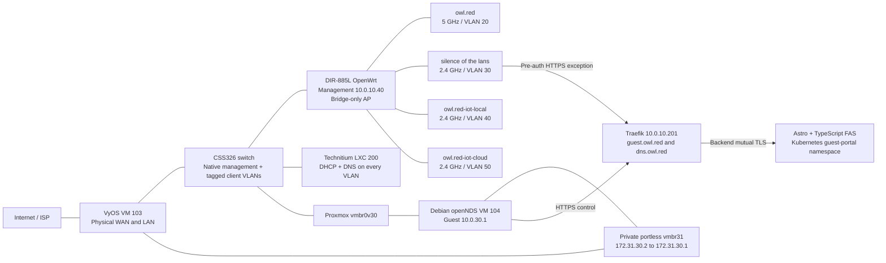
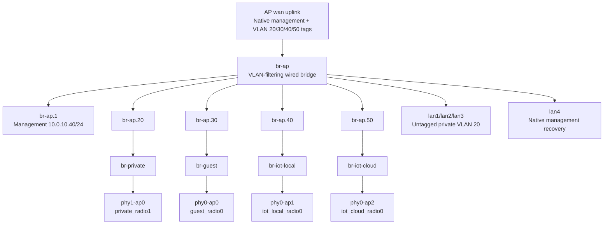
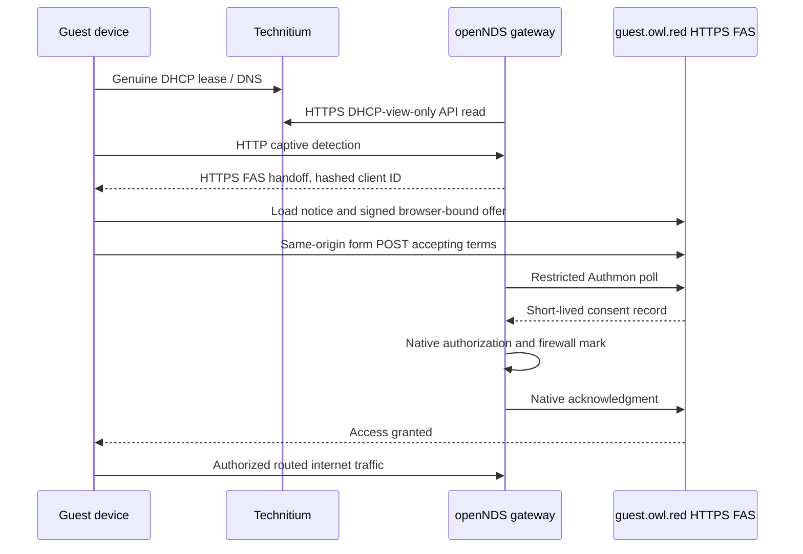

# Wi-Fi Architecture And Operations

## Current Incident: AP Restarts

Guest Wi-Fi is now paused by owner request until the WAP is replaced. The
guest-disabled setting is committed and live verification passed for exactly
three SSIDs: private, local IoT and cloud IoT. Their bridges are `phy1-ap0` to
`br-private`, `phy0-ap0` to `br-iot-local`, and `phy0-ap1` to `br-iot-cloud`.
Only radio0 was reloaded; private 5 GHz settings were unchanged. The gateway,
DHCP scope and portal infrastructure remain in place. This is a mitigation,
not proof that private-client connectivity or restart stability is fixed.
Guest-path diagrams below describe the retained infrastructure, not active guest
wireless service.

On 2026-10-22, the owner reported unusable private Wi-Fi and all SSIDs
disappearing together without a manual reboot. Earlier source, bridge, beacon
and wired guest-path checks did not establish stable real-client connectivity.
Do not treat those checks as acceptance of the AP's reliability.

An explicitly approved single rollback from 25.12.6 to 25.12.2 completed using
the official checksum-verified ImageBuilder and a private identity-preserving
image. Native compatibility and on-device checksum checks passed. The four-SSID
configuration, keys, channel 36 and management identity were preserved; native
configuration verification and confirmation passed.

The AP subsequently changed boot ID again on 25.12.2 without another controller
reboot command. The owner still could not connect. One authorized station and
completed WPA handshakes are not proof that affected clients have internet.
The cause remains unproven: power, hardware and shared driver faults need
separation. Do not repeat flashes or disable the hardware watchdog as recovery.
Check physical power/cabling and agree a bounded next step with the owner.

## Replacement AP Target (Not Yet Deployed)

The owner selected Grandstream GWN7660E on 2026-10-23 in place of the previously
ordered GWN7665; cancellation/refund of the earlier order and purchase/delivery
of the GWN7660E are not confirmed. The intended target has four 2.4 GHz BSSes
(private VLAN 20, guest VLAN 30, local IoT VLAN 40, cloud IoT VLAN 50) and two
5 GHz BSSes (private VLAN 20 and guest VLAN 30). This is six BSSes total, within
the vendor-advertised 16 SSIDs per radio. Keep identical SSID names tied to the
same VLAN/security policy across bands.

The existing MokerLink POE-G083GS is already in the cabinet-to-rack path and
advertises active 802.3af/at PoE; no separate AP injector is planned. The
MokerLink Extend/DIP state, exact uplink ports and tagged-VLAN transparency are
not verified. Do not enable the guest target until the replacement's local
configuration/IaC, VLAN path, backup/recovery and real-client checks pass. This
target is not current live configuration; the old AP recovery hold remains.

This guide describes the accepted implementation, configuration owners and clean
AP refresh procedure. Passwords, API tokens, private keys, firmware images with
preseeded credentials and recovery snapshots stay outside Git.

## Configured SSIDs

| SSID | Band / radio | VLAN | BSS bridge | Gateway | Policy |
|------|--------------|------|------------|---------|--------|
| `owl.red` | 5 GHz / radio1 | 20 | `br-private` | VyOS `10.0.20.1` | Trusted private clients, subject to canonical VyOS rules |
| `silence of the lans` | Paused / disabled | 30 | `br-guest` | openNDS VM `10.0.30.1` | Retained configuration; not broadcasting until WAP replacement and acceptance |
| `owl.red-iot-local` | 2.4 GHz / radio0 | 40 | `br-iot-local` | VyOS `10.0.40.1` | Isolated clients; no internet; explicit local integrations only |
| `owl.red-iot-cloud` | 2.4 GHz / radio0 | 50 | `br-iot-cloud` | VyOS `10.0.50.1` | Isolated clients; internet permitted; no general lateral access |

Both radios are active. Three `wifi-iface` definitions are enabled:
`private_radio1`, `iot_local_radio0`, `iot_cloud_radio0`; `guest_radio0` is disabled.
There are no inactive private-2.4, guest-5 or cloud-IoT-5 definitions in desired
state. Four BSSes on radio0 failed on this hardware/firmware combination; the
owner accepted three on radio0 and one on radio1 rather than repeated experiments.
The 2.4 GHz radio uses channel 1 / HT20 at 8 dBm. After the clean 25.12.6 update,
the owner approved channel 36 / VHT80 at 12 dBm for private 5 GHz because the
updated Broadcom driver rejected the previous channel 149. No power increase or
additional BSS was introduced as a workaround.

All SSIDs retain their existing WPA2/CCMP credentials in Bitwarden. The three
untrusted SSIDs set client isolation. Client isolation is not a replacement for
VLAN boundaries or upstream firewall rules.

The Shield is a private client at `10.0.20.100`. Ecobee remains cloud IoT at
`10.0.50.10`; it reassociated to 2.4 GHz when the extra 5 GHz BSS was retired.

## Components And Traffic Paths



Guest internet traverses the gateway VM, then private transit, then VyOS WAN NAT.
The gateway performs no guest SNAT. VyOS's former direct guest gateway on
`eth1.30` is disabled and its static `10.0.30.0/24` route uses `172.31.30.2`.
The physical WAN/LAN passthrough remains on VyOS; no physical NIC is passed to
the portal gateway. QEMU bootstrap networking is recovery-only and never a guest
forwarding path.

## AP Layer 2



Each BSS attaches to an ordinary bridge above its own tagged subinterface, not
directly to shared `br-ap`. Native netifd owns the network. The reset image's
bounded `owl-bss-bridges` boot service waits for the four hostapd objects and
reconciles these explicit mappings. The regular AP owner also has a guarded
rebind phase for controlled maintenance. A present interface or hostapd `ENABLED`
state alone is not proof of over-the-air visibility.

The AP serves no DHCP, IPv6 RA, captive portal, NAT or routed client traffic.
Its DNS resolver points to `10.0.10.30`; IPv4 and IPv6 forwarding are disabled.

## Address And Service Ownership

Technitium is the sole DHCP/DNS authority, with VLAN-local endpoints
`10.0.10.30`, `10.0.20.30`, `10.0.30.30`, `10.0.40.30`, `10.0.50.30`.
IPv4 pools are `.100-.199` with `/24` masks, normally 24-hour leases and four-hour
guest leases. Reservations are not Wi-Fi profiles: moving a device between SSIDs
must happen on the device before its reservation is migrated.

VyOS owns native/private/IoT routing and their canonical IPv4/IPv6 policy. The
guest gateway owns VLAN 30 forwarding, DNS-only dnsmasq and guest NTP. Its native
time service synchronizes upstream and allows only the guest subnet as clients.

## Guest Authentication And Rules



| Boundary | Enforcement |
|----------|-------------|
| Unauthenticated guest | Internet denied; only required local DNS/NTP/discovery and portal HTTPS are available |
| Portal exception | `10.0.10.201:443` only; VLAN 30 requests for other shared-ingress administration hosts are denied |
| Authenticated internet | Native openNDS authorization mark plus fresh DHCP facts; routed only through `portal-transit` |
| Private destinations | Guest RFC1918/non-public destinations denied, except the exact portal service exception |
| DNS bypass | Guest routed port 53 denied; use the VLAN-local Technitium resolver |
| IPv6 | Guest forwarding denied until equivalent enforcement is separately qualified |
| Lease facts | Dedicated DHCP-view-only token; refresh every 10 seconds; kernel facts expire within 30 seconds |
| Flow offload | Freshness checks run before offload in both guest/transit directions |
| Revocation | Native BinAuth extension removes only the matching guest's preemptive queue and conntrack entries |
| Daemon failure | Independent forward chain defaults to drop; native stop hook closes forwarding |
| Portal control | Source-restricted Authmon ingress, overwritten proxy header and backend mTLS; no direct pod bypass |

VyOS transit rules `6100-6140` permit only scoped portal control, guest portal
access and accepted WAN egress, with private-range denial. NAT `6130` is guest
WAN masquerade; `6140` is the gateway's own WAN egress. Other VLANs retain their
canonical rules; no broad inter-VLAN exception is implied by an SSID name.

The portal requires a signed, short-lived browser-bound offer and same-origin
form POST. `Referrer-Policy: same-origin` preserves browser consent Origin without
leaking handoff URLs cross-site. Origin, signature and cookie checks remain on.
Native Authmon startup clearing must finish before acceptance readiness is claimed.
Ordinary sessions are 120 minutes. DHCP option 114 is not advertised without a
truthful, client-specific CAPPORT endpoint; normal captive detection is used.

## Configuration Owners

| Surface | Source |
|---------|--------|
| AP hardware, active radios/SSIDs, bridge map | [AP group variables](../../ansible/inventory/group_vars/aps.yml) |
| AP native UCI rendering | [network](../../ansible/templates/openwrt-network.j2), [wireless](../../ansible/templates/openwrt-wireless.j2), [DHCP-off](../../ansible/templates/openwrt-dhcp.j2), [firewall](../../ansible/templates/openwrt-firewall.j2) |
| AP reconciliation and access guards | [playbook](../../ansible/playbooks/openwrt-ap.yml), [native module](../../ansible/library/openwrt_ap.py), [runner](../../scripts/openwrt-run.mjs) |
| Pinned firmware and clean reset image | [firmware manifest](../../ansible/vars/openwrt-firmware.json), [refresh runner](../../scripts/openwrt-refresh.mjs) |
| Guest bridge, native guard/services and lease refresh | [gateway playbook](../../ansible/playbooks/guest-portal-gateway.yml) |
| Private transit and VyOS confirmed handoff | [bridge preparation](../../ansible/playbooks/guest-portal-transit.yml), [router playbook](../../ansible/playbooks/guest-portal-router.yml) |
| DHCP scopes/reservations and DNS | [Technitium](../../gitops/technitium/README.md) |
| FAS deployment, TLS and route restrictions | [Fleet bundle](../../gitops/guest-portal/portal.yaml) |
| Portal application and container build | [standalone app repository](https://github.com/d0ntblink/owl.red-guest-captive-portal) |
| VM lifecycle and caveats | [gateway root](../../terraform/proxmox/guest-portal/README.md), [VyOS root](../../terraform/proxmox/vyos-vm/main.tf) |

No staging/preparation run is a routine production health check: those commands
can stop serving when explicit maintenance is granted. The live gateway guards
refuse accidental maintenance by default. Do not run a VyOS VM lifecycle apply
for a Wi-Fi task: the pinned provider previously restarted it despite `reboot=false`.

## Clean AP Reset And Upgrade

The reset/update was performed on 2026-10-22: 25.12.2 to 25.12.6, using
`sysupgrade -n` with the private preseeded image. Trusted management identity was
retained. The native source trial/verify/confirm/finish completed; the approved
channel-36 recovery used one additional AP reboot, not another flash. Current
source has four active BSS definitions and no inactive BSS entries.

Post-recovery verification matched the canonical source without changes and
confirmed all four BSS bridge bindings. A separate Windows over-air scan saw
`owl.red` on channel 36 and guest/local-IoT/cloud-IoT on channel 1; Ecobee was
associated with cloud-IoT on 2.4 GHz. AP SSH automation uses the existing
strict-key management jump through `edge` (`10.0.10.3`), preserving the AP's
trusted host identity without adding firewall exceptions or workstation routes.

The refresh currently pins the rollback target OpenWrt `25.12.2`, `bcm53xx/generic`, exact `dlink_dir-885l`
profile and official checksums. Its generated reset image contains private
credentials and keys and must never be published as an ordinary build artifact.

```bash
node scripts/openwrt-refresh.mjs fetch
node scripts/openwrt-refresh.mjs prepare
node scripts/openwrt-refresh.mjs build
node scripts/openwrt-refresh.mjs stage
# Only in the approved outage, with physical/cabled AP recovery available:
OPENWRT_REFRESH_ALLOWED=true node scripts/openwrt-refresh.mjs apply
node scripts/openwrt-refresh.mjs verify
```

Use the repository-supported Node 24 runtime. Preparation saves a private native
sysupgrade backup plus explicitly configured external LuCI certificate/key files.
The image retains only access-critical SSH host keys, root password hash and
HTTPS identity; the old overlay is not restored. Native `sysupgrade -T`, exact
board/version, on-device SHA-256 and a single-apply marker gate `sysupgrade -n`.
ImageBuilder uses a clean Linux PATH and its required build umask; the enclosing
artifact directory remains private and secret file modes are explicit.

After the new boot, verify firmware/identity, exact four-BSS source, wired
management, actual BSS bridge bindings, visible private/guest SSIDs and guest
DHCP/HTTPS consent. Retire router services on the AP through the normal owner.
Preserve a physical LAN4/native-management recovery path; if firmware does not
boot, use the board's vendor recovery procedure rather than remote force-flashing.

## Acceptance And Remaining Checks

Production namespace acceptance has passed genuine Technitium DHCP, pre-auth
denial, HTTPS consent/native Authmon, established TLS revocation, private/admin
denial and IPv6 denial. The owner also confirmed a real guest-browser login after
the referrer-policy fix. This is not an RF coverage survey or universal handset
compatibility certification. Device playback, roaming, weak-spot coverage and
future hardware/radio expansion remain explicit onsite follow-ups.