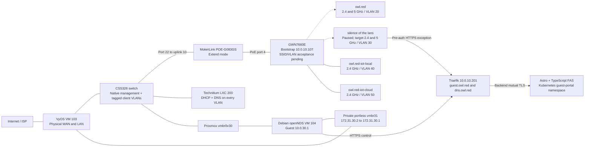
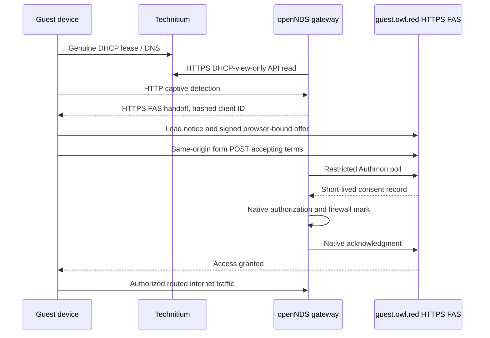

# Wi-Fi Architecture And Operations

## Replacement AP Target (Not Yet Deployed)

The Grandstream GWN7660E arrived and was connected on 2026-10-27. Read-only
SSH status confirms the model, embedded-controller role `Master`, firmware
`1.0.25.34`, part number `9640011012C`, device MAC `ec:74:d7:b3:3e:ba` and
`NET/POE` connected. The previously ordered GWN7665 cancellation/refund remains
unconfirmed. The intended target has four 2.4 GHz BSSes
(private VLAN 20, guest VLAN 30, local IoT VLAN 40, cloud IoT VLAN 50) and two
5 GHz BSSes (private VLAN 20 and guest VLAN 30). This is six BSSes total, within
the vendor-advertised 16 SSIDs per radio. Keep identical SSID names tied to the
same VLAN/security policy across bands.

The owner confirms the installed path: **CSS326 port 22 -> MokerLink uplink 10
-> MokerLink PoE port 4 -> GWN7660E NET/POE**. The MokerLink POE-G083GS supplies
power directly; no separate injector is used. Preserve port 22's existing native
management/client path. The owner confirmed the MokerLink DIP is in **Extend**
on 2026-10-27; leave it unchanged pending a specific need and controlled test.
Advertised PoE-port isolation still permits uplink communication, but does not
prove tagged-VLAN transparency or actual link speed on this installed path.
Do not enable the guest target until the replacement's local
configuration/IaC, VLAN path, backup/recovery and real-client checks pass. This
target is not yet verified live configuration. The Grandstream is the sole AP
hardware target; guest Wi-Fi remains paused until acceptance.

### Bootstrap Discovery And Access

- Current reachable address: `10.0.10.107`, observed 2026-10-27; this is not a
    permanent reservation or DNS allocation.
- SSH login: `admin`; the supplied temporary password remains only in the ignored
    controller secret input under variable `grandstream`. Its file permissions
    were verified as `0600`. Rotate and move it to the established secret store
    during an explicitly scoped credential change; no rotation was performed here.
- Discovery used the existing trusted edge host `10.0.10.3` as the SSH jump.
    The edge neighbor entry matched the MAC above. The AP host key was discovered
    through that host and pinned at controller-local
    `~/.local/state/owl-red/grandstream-discovery/known_hosts`; subsequent login
    enforced strict host-key checking. This is first-use discovery, not independent
    manufacturer identity attestation.
- The native SSH menu's `1` / Status screen supplied the identity above.
    General shell commands are not applicable to this menu.
- Discovery did not change passwords, firmware, SSIDs, VLANs, radio settings,
    DHCP/DNS, switch settings or power. Existing SSID/client configuration,
    address-assignment mode, tagged-VLAN transport, local IaC and recovery remain
    unqualified. Reuse the established SSID names and their vault credentials.

This guide separates the intended AP layout from the retained routing and portal
infrastructure. Passwords, API tokens, private keys and recovery snapshots stay
outside Git.

## Intended SSIDs

These are qualification targets, not a claim that the AP is broadcasting them.
The [shared network profile](../../ansible/vars/wifi-networks.yml) preserves
the established SSID names and upstream network policy; it is not an AP deployer.

| SSID | Intended bands | VLAN | Gateway | Policy |
|------|----------------|------|---------|--------|
| `owl.red` | 2.4 / 5 GHz | 20 | VyOS `10.0.20.1` | Private clients; canonical VyOS rules |
| `silence of the lans` | 2.4 / 5 GHz; paused | 30 | openNDS `10.0.30.1` | Portal consent and isolated guest internet |
| `owl.red-iot-local` | 2.4 GHz | 40 | VyOS `10.0.40.1` | Local-only IoT; no internet |
| `owl.red-iot-cloud` | 2.4 GHz | 50 | VyOS `10.0.50.1` | Internet-enabled IoT; no general lateral access |

Retain the existing Bitwarden Wi-Fi credentials. Apply client isolation to the
three untrusted SSIDs; it does not replace VLAN boundaries or firewall policy.
Qualify radio channels, widths and power for this hardware and the site.

## Components And Traffic Paths

Guest internet traverses the gateway VM, then private transit, then VyOS WAN NAT.
The gateway performs no guest SNAT. VyOS's former direct guest gateway on
`eth1.30` is disabled and its static `10.0.30.0/24` route uses `172.31.30.2`.
The physical WAN/LAN passthrough remains on VyOS; no physical NIC is passed to
the portal gateway. QEMU bootstrap networking is recovery-only and never a guest
forwarding path.

## AP Layer 2

The AP must bridge each SSID to its declared VLAN across the native-management
and tagged-client uplink. It must not replace the existing DHCP, DNS, routing,
NAT or captive-session owners. Verify the entire CSS326/MokerLink/AP path before
client cutover; native management reachability alone does not qualify VLANs.

## Address And Service Ownership

Technitium is the sole DHCP/DNS authority, with VLAN-local endpoints
`10.0.10.30`, `10.0.20.30`, `10.0.30.30`, `10.0.40.30`, `10.0.50.30`.
IPv4 pools are `.100-.199` with `/24` masks, normally 24-hour leases and four-hour
guest leases. Reservations are not Wi-Fi profiles: moving a device between SSIDs
must happen on the device before its reservation is migrated.

VyOS owns native/private/IoT routing and their canonical IPv4/IPv6 policy. The
guest gateway owns VLAN 30 forwarding, DNS-only dnsmasq and guest NTP. Its native
time service synchronizes upstream and allows only the guest subnet as clients.

## Guest Authentication And Rules

| Boundary | Enforcement |
|----------|-------------|
| Unauthenticated guest | Internet denied; only required local DNS/NTP/discovery and portal HTTPS are available |
| Portal exception | `10.0.10.201:443` only; VLAN 30 requests for other shared-ingress administration hosts are denied |
| Authenticated internet | Native openNDS authorization mark plus fresh DHCP facts; routed only through `portal-transit` |
| Private destinations | Guest RFC1918/non-public destinations denied, except the exact portal service exception |
| DNS bypass | Guest routed port 53 denied; use the VLAN-local Technitium resolver |
| IPv6 | Guest forwarding denied until equivalent enforcement is separately qualified |
| Lease facts | Dedicated DHCP-view-only token; refresh every 10 seconds; kernel facts expire within 30 seconds |
| Flow offload | Freshness checks run before offload in both guest/transit directions |
| Revocation | Native BinAuth extension removes only the matching guest's preemptive queue and conntrack entries |
| Daemon failure | Independent forward chain defaults to drop; native stop hook closes forwarding |
| Portal control | Source-restricted Authmon ingress, overwritten proxy header and backend mTLS; no direct pod bypass |

VyOS transit rules `6100-6140` permit only scoped portal control, guest portal
access and accepted WAN egress, with private-range denial. NAT `6130` is guest
WAN masquerade; `6140` is the gateway's own WAN egress. Other VLANs retain their
canonical rules; no broad inter-VLAN exception is implied by an SSID name.

The portal requires a signed, short-lived browser-bound offer and same-origin
form POST. `Referrer-Policy: same-origin` preserves browser consent Origin without
leaking handoff URLs cross-site. Origin, signature and cookie checks remain on.
Native Authmon startup clearing must finish before acceptance readiness is claimed.
Ordinary sessions are 120 minutes. DHCP option 114 is not advertised without a
truthful, client-specific CAPPORT endpoint; normal captive detection is used.

## Configuration Owners

| Surface | Source |
|---------|--------|
| AP hardware and cabling | [Device inventory](../device-inventory.md#ap-main), [MokerLink decision](../decisions/023-mokerlink-poe-rack-switch.md) |
| Shared SSID names and network policy | [Wi-Fi network profile](../../ansible/vars/wifi-networks.yml) |
| AP configuration, firmware and recovery | Grandstream local embedded controller; repeatable IaC and recovery remain unqualified |
| Router policy and guarded switch VLAN operations | [VyOS playbook](../../ansible/playbooks/vyos-wifi.yml), [SwOS playbook](../../ansible/playbooks/swos-ap.yml) |
| Guest bridge, native guard/services and lease refresh | [gateway playbook](../../ansible/playbooks/guest-portal-gateway.yml) |
| Private transit and VyOS confirmed handoff | [bridge preparation](../../ansible/playbooks/guest-portal-transit.yml), [router playbook](../../ansible/playbooks/guest-portal-router.yml) |
| DHCP scopes/reservations and DNS | [Technitium](../../gitops/technitium/README.md) |
| FAS deployment, TLS and route restrictions | [Fleet bundle](../../gitops/guest-portal/portal.yaml) |
| Portal application and container build | [standalone app repository](https://github.com/d0ntblink/owl.red-guest-captive-portal) |
| VM lifecycle and caveats | [gateway root](../../terraform/proxmox/guest-portal/README.md), [VyOS root](../../terraform/proxmox/vyos-vm/main.tf) |

No staging/preparation run is a routine production health check: those commands
can stop serving when explicit maintenance is granted. The live gateway guards
refuse accidental maintenance by default. Do not run a VyOS VM lifecycle apply
for a Wi-Fi task: the pinned provider previously restarted it despite `reboot=false`.

## Acceptance And Remaining Checks

Production namespace acceptance has passed genuine Technitium DHCP, pre-auth
denial, HTTPS consent/native Authmon, established TLS revocation, private/admin
denial and IPv6 denial. The owner also confirmed a real guest-browser login after
the referrer-policy fix. This is not an RF coverage survey or universal handset
compatibility certification. Device playback, roaming, weak-spot coverage and
future hardware/radio expansion remain explicit onsite follow-ups.