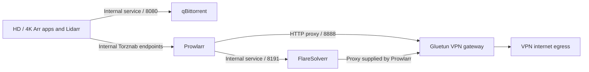

# Arr Access And Integration Endpoint Failures

## Status

Application access and internal integrations repaired on 2026-10-23. Three
external providers still failed their bounded acceptance tests; they are not
included in the claim that the application connections were restored.

## Symptoms And Causes

| Symptom | Confirmed cause | Repair |
|---------|-----------------|--------|
| Sonarr, Radarr and Lidarr could not reach qBittorrent, including HD/4K instances | All six Arr download-client records used the external `qbittorrent-direct.owl.red:8080` endpoint; native tests timed out or failed from the application pods | Use `qbittorrent.qbittorrent.svc.cluster.local:8080`, preserving credentials, categories and paths |
| Prowlarr reported its indexer proxy unavailable | FlareSolverr used `http://flaresolverr.owl.red:8191`, whose LoadBalancer was restricted to the NAS source rather than the new application pods | Use the existing internal solver service |
| Prowlarr was not using Gluetun | Global proxy was disabled and retained the retired `qbittorrentvpn:8118` address; the current Gluetun HTTP proxy was off | Enable the existing Gluetun proxy behind a ClusterIP-only service and configure Prowlarr's native HTTP proxy |
| Radarr HD rejected the expected login | The live account did not accept the credentials in the owner's existing Bitwarden **ARR Access** item; the other five Arr login checks passed | Align only Radarr HD to the existing vault credentials and verify the native form login |
| 4K instances were difficult to find | Home omitted both UHD URLs and still grouped live media services as planned; the vault item contained legacy URLs | Add explicit HD/4K entries to home and replace the vault URLs with the six current HTTPS endpoints |

The investigation did not establish when or why Radarr HD's account diverged.
Do not attribute that credential change to a specific migration step without
evidence. Existing API keys were retained; no authentication bypass was added.

## VPN And Solver Routing

The proxy service is `gluetun-proxy.qbittorrent.svc.cluster.local:8888` and has
no ingress or external LoadBalancer port. The VPN firewall remains enabled.
Prowlarr bypasses its proxy for `\.svc\.cluster\.local` and local addresses;
the regex must match URLs containing ports, not just a bare hostname. This
keeps internal app/solver calls direct while the solver's browser requests use
the VPN proxy supplied by Prowlarr.

## Acceptance

- Expected vault logins passed for Prowlarr, both Sonarr instances, both Radarr
  instances and Lidarr. Five already-working accounts were left unchanged.
- Native qBittorrent connection tests passed in all six applications.
- Prowlarr's five application-peer connection tests passed and native indexer
  synchronization was requested.
- Each media app passed a downstream native indexer test through Prowlarr:
  YTS for Radarr HD and The Pirate Bay for the other four apps.
- Prowlarr's FlareSolverr test and actual HTTPS egress through Gluetun passed;
  solver requests recorded the native VPN proxy parameter.
- EZTV, EZTVL, SubsPlease, The Pirate Bay and YTS passed provider tests.
  Nyaa.si returned a gateway timeout; 1337x and RuTracker timed out during
  upstream/browser challenge handling. They were not silently disabled or
  rerouted outside the VPN.
- All six HTTPS login URLs responded successfully. No download, library
  import, media move or credential-bearing URL was used for acceptance.

During the gateway's `Recreate` rollout, its old Pod object remained terminating.
It was cleared only after the three application containers were confirmed
stopped or absent. The replacement reached four ready containers, with no
duplicate application writer introduced.

## Prevention And Recovery

Migration acceptance must include native downloader/indexer tests and expected
interactive login checks, not only API-key status endpoints and pod readiness.
Use service DNS for cluster peers; external administration endpoints retain their
source restrictions. Keep HD and UHD URLs explicit in home and the vault.

Use the existing [Arr controller](../../scripts/arr-batch-run.mjs) read-only
inspection and bounded verification phases. Do not replay migration `stop` or
`seed`: the old NAS writers and files are not the current databases. The old
NAS migration baseline was absent during this investigation; live keys were
read privately from each running application's config instead.

Mutating repair phases require `ARR_REPAIR_ALLOWED=true` and save private
controller preimages outside Git. The gateway source must be published through
the reviewed Fleet lane before a future rollout; a live patch alone does not
update GitOps desired state. Publishing remains a separate operational action.

See [current access and commands](../guides/shared-storage.md#arr-access-and-integration-recovery)
and the [home dashboard source](../../gitops/dashboards/homepage.yaml).